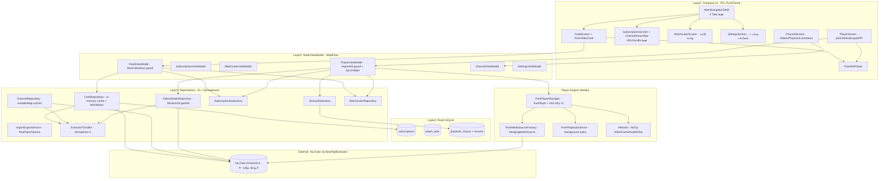

# 🛡️ PureTube — وثيقة الفجوات نحو نسخة جاهزة للعمل الحقيقي
> **النوع:** تحليل معماري عميق + خطة إنتاج (Production Readiness Gap Analysis)
> **التاريخ:** 2026-10-12 | **الهدف:** نسخة يستطيع مستخدم YouTube / NewPipe الاعتماد عليها يومياً دون الشعور بالنقص أو الهواة
> **الجمهور:** المالك + المطورون + وكلاء التنفيذ | **الفلسفة الحاكمة:** حماية من المحتوى المخل + أمان الأطفال + لا خوارزميات إدمان + جاهزية AI لاحقاً

---

## 0. الخلاصة التنفيذية (Executive Summary)

PureTube has a solid V1 safe-core (MVVM + Room + NewPipeExtractor + Media3 + Koin + PureTheme SSOT + NoOp AI hooks) with premium RTL-first UX, but it is **not yet a drop-in replacement** for YouTube/NewPipe: there is no global shielded search, no History/Library UI despite a full History engine, no playlists/queue, captions, safe-comments, downloads, background-refresh worker, or parental PIN — a YouTube/NewPipe migrant will instantly feel the app is incomplete/amateur without these table-stakes.

> **بالعربية:** البنية التحتية ممتازة والهوية البصرية فاخرة، لكن التطبيق اليوم `مشغّل اشتراكات مغلق` وليس `بديل يوتيوب`. هذه الوثيقة تحوّل التقرير التحليلي إلى **خطة تنفيذ مرتبة P0/P1/P2** بمعايير قبول واضحة، بحيث كل بند مغلق = خطوة نحو APK يُشحَن بثقة.

**تعريف `جاهز للعمل الحقيقي` (Definition of Done للإصدار 1.0):**
1. مستخدم YouTube يجد أي فيديو حلال يبحث عنه خلال 10 ثوانٍ (بحث محمي).
2. مستخدم NewPipe يستورد اشتراكاته ويجد سجله وقوائمه وتحميلاته كما اعتاد.
3. أب يسلّم الهاتف لطفل 8 سنوات دون خوف (PIN + فلتر + وضع أطفال).
4. لا شاشة بيضاء / لا ضياع استئناف / لا انهيار عند انقطاع الشبكة أو انتهاء روابط DASH.
5. `0 حرج / 0 رئيسي` في مراجعة multi-agent + `42+ اختبار أخضر` + Migrations لـ Room.

---

## 1. خريطة المعمارية وتدفق البيانات

**التتبع الشامل (Anti-Blindspot):**
- **UI:** `MainActivity backstack + Shell 4 tabs + Player 3 modes + Channel 4 tabs + MiniPlayer` — لا بحث عام، لا مكتبة، لا قوائم.
- **State:** `StateFlow + requestId guard + AtomicBoolean + SyncHelper 5s` — سليم لكن بثغرات موت العملية (انظر F1).
- **Repo:** `Semaphore(4) + Result + in-memory cache` — يحمي IP لكن يتبخر بالموت (انظر F2).
- **DB:** `Room 3 جداول + DAOs كاملة` — محرك السجل جاهز بلا واجهة، `destructive fallback` يمنع الشحن.

---

## 2. الجرد الجراحي: ماذا يوجد وماذا ينقص؟

### 2.1 الواجهات وتجربة المستخدم (تم التحقق كودياً)

| الواجهة | الحالة | الدليل |
|---|---|---|
| تبويبات 4 فقط (رئيسية/اشتراكات/لاحقاً/إعدادات) — لا بحث ولا مكتبة | ✅ يعمل / ⚠️ ناقص استراتيجياً | `PureNavTab.kt:L18-L43` — enum بأربع قيم فقط |
| `MainNavigationShell` + انتقال fade + MiniPlayer فوق البار | ✅ | `MainNavigationShell.kt:L32-L87` |
| `MainActivity` + backstack مخصص + auto-PiP عند `onUserLeaveHint` | ✅ | `MainActivity.kt:L61-L222` |
| `FeedScreen`: header زر تحديث + shimmer + empty + error + LazyColumn — **بدون Pull-to-Refresh** | ✅ / ناقص UX قياسي | `FeedScreen.kt:L50-L174` |
| `ChannelSearchBar`: لصق رابط/`@handle` فقط — **ليس بحث يوتيوب** (صفر `SearchInfo/SearchExtractor` في الكود) | ⚠️ تضليل تسمية | `features/subscriptions/components/ChannelSearchBar.kt` |
| `ChannelScreen` + 4 تبويبات + مشاركة `ACTION_SEND` | ✅ جيد | `features/channel/ChannelScreen.kt` + `ChannelHeader.kt:L199-L263` |
| `PlayerScreen`: عمودي/أفقي immersive/ PiP + إخفاء تلقائي 3.5s + sheets (سرعة/جودة/نوم) | ✅ قوي | `PlayerScreen.kt:L52-L296` |
| وصف قابل للطي + فصول مستنبطة من `TimestampParser` (ليست فصول يوتيوب الأصلية) | ✅ جزئي | `VideoDescriptionCard.kt:L31-L76` + `VideoChaptersRow.kt:L29-L76` |
| `PureVideoCard` فاخرة 16:9 + شارة مدة + bookmark + Coil | ✅ | `PureVideoCard.kt:L46-L100` |
| `SettingsScreen`: إحصائيات + 6 ثيمات + عن التطبيق — **لا حماية/PIN/فلتر/تصدير/مؤقت** | ⚠️ تكذّب وعد `آمن للأطفال` | `SettingsScreen.kt:L38-L77` |
| `WatchLaterScreen`: قائمة واحدة + مسح الكل — لا قوائم متعددة | ✅ / ناقص | `WatchLaterScreen.kt:L52-L60` |

**نظام التصميم:** `PureTheme SSOT` (`Color/PureColors/ThemePreset/PureTheme`) + 6 ثيمات + `supportsRtl=true` + `PureEmptyState/Error/Shimmer` + إيماءات دبل-تاب/سحب + `Audio-Only + PiP + SleepTimer`. لا onboarding، لا haptic، لا رسوم فراغ مخصصة.

### 2.2 المنطق البرمجي

- **Feed:** `FeedViewModel.loadFeed:L101-L142` بحارس `AtomicBoolean` + `FeedRepository.getFeed:L67-L176` بكاش ذاكرة + `fetchMutex/cacheMutex` + fallback — يمنع `thundering herd` لكن يتبخر بموت العملية.
- **Player:** `PlayerViewModel.loadVideo:L111-L240` بحارس `requestId` ضد `stale-win` + `observeChannelAndBookmarkState + loadChannelVideos(limit=15)` غير قاتل + `SyncHelper.start 5s` فقط إذا `isPlaying`.
- **Details:** `VideoDetailsRepository:L39-L118` يستخرج `videoOnly+progressive+audio+description+viewCount` فقط — **لا تعليقات/إعجابات/ترجمة/فصول أصلية/كلمات**.
- **Portability:** `ImportExportService parseNewPipeJson/parseGoogleTakeoutCsv` + dedup — ممتاز لمهاجري NewPipe.
- **Player engine:** `PurePlayerManager:L49-L421` — ExoPlayer + إصلاح Opus API29 + `StateFlows` + `tracker 500ms` + `403 retry×1` + `release()` غير مستدعى من `MainActivity` (singleton مقصود — وثّقه).
- **Models:** `FeedVideoItem` (7 حقول فقط) + `ExtractedVideoDetails` بسقف `AUTO/1080/720/480/360` (لا 4K/1440 ولا 144p للشبكة الضعيفة).

### 2.3 مصفوفة الوظائف: أساسي / فرعي / غائب

**يعمل:** خلاصة زمنية بلا خوارزمية، إضافة قناة، حزمة 6 قنوات، مشغل DASH، خلفية صوتية، PiP، سرعة/جودة، نوم، استئناف، لاحقاً، قناة/قوائم/بث، استيراد/تصدير، 6 ثيمات، RTL.
**جزئي:** مشاركة، فصول من الوصف، related بنفس القناة فقط (صح فلسفياً)، إحصائيات أعداد.
**غائب (يشعِر بالهواة):** بحث عام، مكتبة/سجل UI، playlists/queue/autoplay-next، تعليقات آمنة، إعجابات، captions، تحميل، تنبيهات Worker، PIN/فلتر/وضع أطفال، مؤقت استخدام، pull-refresh، جودة افتراضية، استقبال مشاركة من يوتيوب، نسخ مجدول.

---

## 3. أوضاع الفشل الحرجة (Red-Team Gate — 3 إلزامية)

### F1 — ضياع موضع الاستئناف (State vs DB desync) — حرج
- **المحفز:** إيقاف مؤقت عند `12:30` ثم قتل التطبيق خلال نافذة `5s`، أو مشاهدة `96%` متوقفاً قبل عتبة `95%` دون `STATE_ENDED`.
- **المسار:** `PlayerPlaybackSyncHelper.kt:L40-L59` يحفظ فقط إذا `isPlaying && pos>0`. `persistCurrentPlaybackPosition()` في `pause/back/dispose` فقط وليس `onStop/process-death`. `markCompleted` داخل نفس الحلقة عند `pos>=dur*95/100` — إن توقف `isPlaying` قبلها لا يُعلَّم أبداً.
- **Blast radius:** كل استئناف يعرض وقتاً قديماً → إحباط + إعادة مشاهدة، مدمّر لثقة `آمن للأطفال/دروس`.
- **الإصلاح (P0):** حفظ على `STATE_ENDED` مباشرة + `flush بـ NonCancellable` في `onStop` + قراءة `player.currentPosition` كمصدر حقيقة + اختبار `process-death resume`.

### F2 — تبخّر الخلاصة + سباق الكاش — رئيسي
- **المحفز:** 20 قناة + شبكة متقطعة + قتل العملية + فتح بارد.
- **المسار:** `FeedRepository.kt:L67-L176` كاش ذاكرة فقط يضيع بالموت، إعادة الجلب عبر `Semaphore(4)` تأخذ 10-20s بشاشة فارغة بلا pull-refresh. `ChannelRepository playlistsCache/liveCache: mutableMap` تُكتب من `async` متعددة بلا `Mutex` → خطر `ConcurrentModificationException`.
- **Blast:** خلاصة بيضاء تُقرأ كـ `app broken` + تقييم نجمة واحدة.
- **الإصلاح (P0):** لقطة Room للخلاصة + `Mutex` للخرائط + `PullToRefreshBox` + `WorkManager` دوري + شارة `آخر تحديث منذ X` + اختبار `airplane-mode fallback`.

### F3 — انكسار البث + الإحساس بالهواة — رئيسي
- **المحفز:** روابط DASH تنتهي (~6h) → `403`، أو يوتيوب يغيّر التوقيع → كل الاستخراج يفشل.
- **المسار:** `PurePlayerManager` يحاول مرة واحدة ثم `errorMessage=تعذر استخراج` عام بلا تمييز `رابط منتهي vs مستخرج قديم`، ولا بانر `حدّث التطبيق`. ومع غياب captions/queue/search يعود المهاجر فوراً.
- **Blast:** `لا يعمل` في المراجعات.
- **الإصلاح (P0/P1):** تمييز `403-refresh` تلقائي + بانر `YouTube غيّر الحماية — تحقق من التحديث` بفحص إصدار Extractor + `retry` ذكي + captions/queue لتخفيف الإحباط.

---

## 4. خطة الإنتاج: ماذا يجب حله لكي لا يشعر المستخدم بالنقص؟

> القاعدة: لا نضيف `Trending/Shorts-feed/Recommendations` أبداً — هذا تميّزنا الأخلاقي. نعوّضه بـ `بحث محمي + مكتبة + قوائم واعية` فيبدو كاملاً دون خيانة الفلسفة.

### P0 — قاتل: لا شحن بدونه (2-3 أسابيع)

| # | البند | معيار القبول | الملفات المستهدفة |
|---|---|---|---|
| P0-1 | تبويب **بحث محمي** (خامس) باستخدام `SearchInfo` + فلترة (قنوات موثوقة + كلمات محظورة + إخفاء shorts/thumbnails مريبة) + سجل بحث محلي | بحث `قرآن تفسير` يعرض نتائج <3s مع شارة `موثوق`، وبحث `موسيقى/رقص` يُحجب بلطف | `features/search/*` جديد + `ChannelRepository` + `PureVideoCard` |
| P0-2 | تبويب **المكتبة/السجل** فوق المحرك الجاهز: `continue watching` + progress bar + حذف فردي/مسح الكل + `empty state` | قتل العملية عند `12:30` → استئناف `12:30` بعد الفتح؛ اختبار موت العملية أخضر | `features/library/*` جديد + `HistoryDao/HistoryRepository/SyncHelper` |
| P0-3 | **قوائم تشغيل + Queue + تشغيل تالي اختياري** (مطفأ افتراضياً) | إنشاء `دروس البرمجة` + إضافة 10 فيديوهات + تشغيل متتابع + MiniPlayer يعرض التالي | `features/playlists/*` + Room `playlists` table + Migration |
| P0-4 | **Captions + حفظ تفضيلات + سلم جودات كامل** (`144p/240p/...+1440p/2160p` حيث توفر) | فيديو مترجم يعرض CC عربية؛ شبكة 2G تعمل على 144p؛ السرعة المختارة تُتذكَّر | `VideoDetailsRepository` + `PureMediaSourceFactory` + `PurePlayerManager` + `SettingsScreen` |
| P0-5 | **قفل أبوي PIN + فلتر كلمات مفعّل + وضع أطفال** يخفي الحذف/الإعدادات/الوصف الخارجي | تفعيل PIN يمنع فتح الإعدادات/إلغاء الاشتراك؛ كلمة محظورة في عنوان → حجب البطاقة + Log | `SettingsScreen/SettingsViewModel` + `FeedRepository` filter + `ThemePreferences`-like `ShieldPreferences` |
| P0-6 | **إصلاحات F1/F2/F3**: `STATE_ENDED flush` + لقطة Room + `Mutex` + بانر `مستخرج قديم` + pull-refresh | `0` ضياع استئناف في اختبار القتل؛ خلاصة فورية من اللقطة ثم تحديث؛ بانر عند فشل شامل | `PlayerViewModel/SyncHelper/FeedRepository/ChannelRepository/FeedScreen` |
| P0-7 | **Room Migrations + إزالة destructive fallback** + نسخ احتياطي/استعادة كامل (اشتراكات+قوائم+سجل+إعدادات) | ترقية DB من vN إلى vN+1 دون فقدان؛ ملف JSON يستعاد على جهاز جديد | `DatabaseModule/PureTubeDatabase/*Dao` |

### P1 — لإقناع مهاجري NewPipe/YouTube (2 أسابيع بعد P0)

| # | البند | معيار القبول |
|---|---|---|
| P1-1 | `Pull-to-refresh + WorkManager` تنبيهات `فيديو جديد` + شارة `جديد` + `آخر تحديث منذ X` | إشعار عند فيديو جديد من اشتراك مُفعَّل؛ السحب يحدّث |
| P1-2 | تعليقات آمنة نصية (بلا صور) + إعجابات/مشاهدات + وصف بروابط نشطة وطوابع زمنية قابلة للنقر | درس برمجي: مراجعه تنقر وتعمل |
| P1-3 | Onboarding 3 خطوات + حزم مصنفة (قرآن/أطفال/تعليم/وثائقي/تقنية) مع صور وتحقّق | أول تشغيل → 3 نقرات → خلاصة ممتلئة، لا شاشة فارغة |
| P1-4 | استقبال مشاركة من يوتيوب (`ACTION_SEND`/`VIEW`) + زر `فتح في PureTube` + `copy link` | مشاركة رابط من Chrome تفتح المشغل مباشرة |
| P1-5 | إحصائيات `وقت المشاهدة اليومي + مؤقت إطفاء + تذكير استراحة` (للتعافي) | `استخدمت 45د اليوم` + إطفاء تلقائي |

### P2 — بعد الاستقرار، ثم AI (لاحقاً)

| # | البند | ملاحظة |
|---|---|---|
| P2-1 | تحميل أوفلاين مشفّر (قائمة `تحميلاتي` + حد حجم + WiFi فقط) | يتطلب `DownloadManager/Media3-Download` + تشفير Room paths |
| P2-2 | تفعيل `VideoFrameHook/AudioFilterHook` تدريجياً (تمويه + كتم موسيقى) عبر `halalify-ai-core` دون لمس المشغل | البنية جاهزة `NoOp` — اربط C++/LiteRT عبر المنافذ فقط |
| P2-3 | مزامنة سحابية اختيارية مشفّرة + دعم أجهزة متعددة | بعد P0/P1، وبموافقة خصوصية صريحة |

---

## 5. معايير الإطلاق (Release Gates — لا تُتجاوَز)

- [ ] `P0-1 → P0-7` مغلقة باختبارات خضراء (`./gradlew test` ≥ 60 اختبار، 0 فشل).
- [ ] مراجعة `multi-agent-reviewers`: `0 حرج / 0 رئيسي`.
- [ ] اختبارات يدوية: (1) وضع طيران + خلاصة قديمة، (2) قتل أثناء إيقاف مؤقت، (3) 403 مستخرج قديم، (4) بحث محظور، (5) PIN أطفال، (6) استيراد NewPipe/Takeout حقيقي.
- [ ] `Room Migrations` + `allowBackup=false` + `dataExtractionRules` سليمة + لا `destructive fallback` في `release`.
- [ ] `proguard-rules` + `APK release` + `versionCode bump` + سجل تغيير عربي.
- [ ] بعد P1: تقييم داخلي من 5 مستخدمين (2 من يوتيوب + 2 من NewPipe + 1 أب) — سؤال واحد: `هل شعرت أن شيئاً ناقص؟` يجب أن تكون الإجابة `لا`.

---

## 6. ملحق: أدلة جراحية سريعة للمنفّذ

- التبويبات: `features/navigation/PureNavTab.kt:L18-L43` + `MainNavigationShell.kt:L32-L87`
- الخلاصة: `features/feed/FeedScreen.kt:L50-L174` + `FeedViewModel.kt:L101-L142` + `core/data/repository/FeedRepository.kt:L67-L176`
- الاشتراكات: `features/subscriptions/SubscriptionsViewModel.kt:L62-L97` (`addChannel`) + `ChannelSearchBar.kt`
- المشغل: `features/player/PlayerScreen.kt:L52-L296` + `PlayerViewModel.kt:L111-L240,L242-L279,L300-L349` + `player/PurePlayerManager.kt:L49-L421` + `PlayerPlaybackSyncHelper.kt:L30-L80`
- التفاصيل: `core/data/repository/VideoDetailsRepository.kt:L39-L118` + `core/data/model/ExtractedVideoDetails.kt:L61-L75` + `FeedVideoItem.kt:L8-L18`
- القناة: `features/channel/ChannelScreen.kt` + `ChannelHeader.kt:L199-L263`
- السجل (محرك بلا واجهة): `core/database/dao/HistoryDao.kt:L16-L42` + `HistoryRepository.kt`
- الحزمة: `core/extractor/pack/CuratedStarterPack.kt:L11-L69` (6 قنوات `@handle` بلا avatar — تحقّق منها في Onboarding)
- الاستيراد: `core/extractor/portability/ImportExportService.kt:L18-L80`
- الإعدادات: `features/settings/SettingsScreen.kt:L38-L77`
- المواصفات: `SPECIFICATION.md` + `DESIGN_SYSTEM.md` + `specs/001-core-data-engine|002-ui-and-navigation|003-player-engine`

> **للوكيل القادم:** ابدأ بـ `P0-1 (بحث محمي)` ثم `P0-2 (مكتبة)` بالتوازي مع `P0-6 (إصلاحات F1/F2)`. لا تبنِ داخل شاشات مؤقتة. كل لون عبر `PureTheme.colors.*`، كل زمن `Long ms`، كل استخراج تحت `ExtractorThrottler` + `Dispatchers.IO`، وكل نص عربي RTL أولاً.
