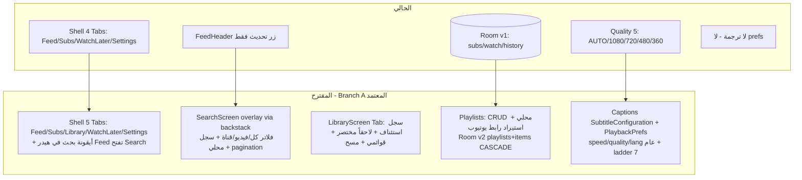

# 📋 الخطة الرئيسية — إضافة (بحث عام + مكتبة + قوائم متعددة + ترجمة/حفظ سرعة وجودة)
> **Artifact:** `implementation_plan.md` | **الوضع:** تخطيط فقط — صفر كود — بانتظار موافقتك الصريحة (`ابدأ/نفذ/Approved`)
> **قرارات المستخدم المعتمدة:** (1) البحث أيقونة في الأعلى تفتح شاشة (لا تبويب جديد) (2) بحث فيديوهات+قنوات مع فلاتر + سجل محلي (3) قوائم محلية + استيراد قائمة يوتيوب عبر رابط (4) سرعة/جودة/لغة ترجمة إعداد عام + CC متوقف افتراضياً

## 1. الملخص التنفيذي والقيمة
- **القيمة:** يتحول PureTube من `مشغّل اشتراكات مغلق` إلى `بديل يومي حقيقي`: أي فيديو يُكتشَف بالبحث، أي تقدم يُستأنَف من المكتبة، أي مجموعة تُنظَّم في قوائم (محلية ومستوردة)، وأي درس يُشاهَد بترجمة وسرعة/جودة محفوظة — دون أي فلتر حماية الآن (يُضاف لاحقاً كما طلبت).
- **النطاق المحظور:** لا فلتر كلمات، لا إخفاء thumbnails، لا PIN/وضع أطفال في هذه الدفعة.
- **المبدأ:** تكامل داخل `MainNavigationShell + backstack` وإعادة استخدام `PureVideoCard/Empty/Error/Shimmer + ExtractorThrottler + Room + PureTheme RTL` — لا Activities منفصلة.

## 2. المعمارية: الحالي vs المقترح

**التدفقات:**
- بحث: `Search icon → ScreenDestination.Search → SearchViewModel(debounce 500ms + job.cancel) → SearchRepository(YoutubeSearchExtractor + getPage) → StreamInfoItem/ChannelInfoItem → FeedVideoItem/ChannelRow → click video→Player / channel→ChannelScreen` + حفظ `search_history` محلي.
- مكتبة: `Library Tab → LibraryViewModel(HistoryFlow 100 + WatchLaterFlow + PlaylistsFlow) → ContinueWatching(progress) + actions(مسح/حذف)`.
- قوائم: `إنشاء/تسمية/حذف + إضافة من (مشغل/خلاصة/بحث/قناة) via AddToPlaylistSheet + استيراد رابط → PlaylistExtractor → items bulk @Transaction`.
- ترجمة/جودة: `VideoDetailsRepository + subtitles → SubtitleTrack(url/mime/lang) → PureMediaSourceFactory.createMediaSource(+subtitleConfigs) → PlayerManager.setQuality/setPlaybackSpeed/setCaption + PlaybackPrefs.persist → sheets تعرض ladder + CC selector`.

## 3. أوضاع الفشل الثلاثة والتخفيف (Red-Team)
1. **F1 عاصفة البحث (stampede + stale-win):** كتابة سريعة تطلق extractor لكل حرف → حظر IP + نتيجة قديمة تغلب الجديدة. **التخفيف:** `debounce 500ms + loadJob.cancel + requestId guard (كما في PlayerViewModel) + empty-query guard + ExtractorThrottler.safeExtract + pagination فقط عند التمرير للنهاية + سجل محلي Room بحد 30`.
2. **F2 تمزق القوائم (partial writes + أيتام):** إنشاء قائمة + إضافة بالك + استيراد 50 فيديو دون `@Transaction` → تكرار PK/أيتام عند حذف القائمة. **التخفيف:** `PlaylistEntity + PlaylistItemEntity(FK CASCADE + indices(videoId,playlistId)) + @Transaction(insertPlaylistWithItems/clearPlaylist) + Migration v1→v2 + distinctBy videoId + اختبار استيراد مكرر`.
3. **F3 انحدار الترجمة/الجودة:** `StreamInfo.subtitles` null/فارغة أو روابط VTT منتهية كـ DASH؛ سلم `144p/240p` قد يختار null لفيديوهات قديمة؛ prefs عام يتسرب بين فيديوهات. **التخفيف:** `SubtitleTrack? nullable + SubtitleConfiguration فقط عند non-empty + fallback chain (مختارة→تلقائية→progressive) + PlaybackQuality موسعة AUTO/1080/720/480/360/240/144 (+1440 إن توفر) + PlaybackPrefs مستقل عن ThemePreferences + اختبار null-subtitles`.

## 4. مخطط الفروقات الجراحية (Surgical Diff Blueprint)

### [NEW] ملفات جديدة
- `core/data/model/SearchResult.kt` — `sealed SearchResultItem(Video(channelId..)/Channel) + SearchFilter(ALL/VIDEOS/CHANNELS)`
- `core/data/model/SubtitleTrack.kt` — `data SubtitleTrack(url,mimeType,languageCode,label,isAutoGenerated)`
- `core/data/model/PlaylistWithMeta.kt` — عروض `Playlist(id,name,count,thumb,createdAt) + PlaylistDetail(items)`
- `core/database/entity/PlaylistEntity.kt` + `PlaylistItemEntity.kt` (FK CASCADE + indices)
- `core/database/dao/PlaylistDao.kt` + `SearchHistoryDao.kt` (أو `search_history` كـ SharedPrefs بحد 30 — القرار: Room لتوحيد الاختبار)
- `core/database/Migrations.kt` — `MIGRATION_1_2 (CREATE playlists/items/search_history)`
- `core/data/repository/SearchRepository.kt(+Impl)` — `search(query,filter,page) + getNextPage + Suggestion? مؤجل`
- `core/data/repository/PlaylistRepository.kt(+Impl)` — `CRUD + add/remove/isIn + importFromYoutubeUrl(PlaylistExtractor) @Transaction`
- `core/data/repository/PlaybackPrefs.kt` — `speed:Float + quality:PlaybackQuality + captionLang:String? + ccEnabled:Boolean (StateFlows + SharedPrefs apply)`
- `features/search/SearchScreen.kt + SearchViewModel.kt + components/SearchBarField.kt + SearchFilterRow.kt + SearchHistoryRow.kt`
- `features/library/LibraryScreen.kt + LibraryViewModel.kt + components/ContinueWatchingCard.kt`
- `features/playlists/PlaylistsScreen.kt(?) مدمجة في Library + PlaylistDetailScreen.kt + PlaylistViewModel.kt + sheets/AddToPlaylistSheet.kt + CreatePlaylistDialog.kt`
- `features/player/components/CaptionSelectionRow.kt` (داخل sheets) + توسيع `QualitySelectionSheet/PlaybackSpeedSheet`
- اختبارات: `SearchRepositoryTest + PlaylistRepositoryTest(Room in-memory) + PlaybackPrefsTest + SearchViewModelTest + LibraryViewModelTest + PureMediaSourceFactoryCaptionsTest`

### [MODIFY] تعديلات دقيقة
- `features/navigation/PureNavTab.kt:L18-L43` — إضافة `LIBRARY(المكتبة)` فقط (لا SEARCH tab حسب قرارك) + أيقونات `VideoLibrary`.
- `features/navigation/MainNavigationShell.kt:L32-L87` — فرع `LIBRARY→LibraryScreen` + تمرير `onSearchClick/onVideoClick/onChannelClick/onPlaylistClick + miniPlayerContent`.
- `features/feed/FeedScreen.kt` — إضافة `onSearchClick` في `FeedHeader` (أيقونة عدسة) دون كسر `onRefreshClick`.
- `MainActivity.kt:L61-L222` — إضافة `ScreenDestination.Search(query?) + PlaylistDetail(playlistId)` للـ backstack + `serialize/deserialize` + تمرير callbacks.
- `core/database/PureTubeDatabase.kt:L17-L30` — entities +Playlist/SearchHistory + `version=2` + ربط `MIGRATION_1_2` في `DatabaseModule` (وإزالة destructive-fallback في release).
- `core/data/model/ExtractedVideoDetails.kt:L49-L55` — توسيع `PlaybackQuality` إلى `AUTO/1080/720/480/360/240/144 (+ HD_1440 إن أردت)` + حقل `subtitles:List<SubtitleTrack>`.
- `core/data/repository/VideoDetailsRepository.kt:L39-L118` — استخراج `streamInfo.subtitles: List<SubtitleInfo>` → `SubtitleTrack` (null-safe, dedup lang, prefer vtt/srt) دون كسر `videoStreams/audioStreams`.
- `player/PureMediaSourceFactory.kt:L41-L83` — توسيع `createMediaSource(details,quality,isAudioOnly,excludeOpus,subtitleTracks,selectedLang,ccEnabled)` → `SingleSampleMediaSource` للترجمة + `MergingMediaSource(video,audio,subs)` + `selectVideoStream` fallback للسلم الجديد.
- `player/PurePlayerManager.kt` — `setQuality/setPlaybackSpeed/setCaptionLang/setCcEnabled` + تطبيق `PlaybackPrefs` عند `loadVideo` + `SubtitleConfiguration` عبر `PlayerView`.
- `features/player/PlayerViewModel.kt` — حقن `PlaybackPrefs + PlaylistRepository` + `togglePlaylistMembership + setCaption` + قراءة prefs عند التحميل.
- `features/player/sheets/*` — إضافة `144p/240p` + صف CC + `تذكر اختياري`.
- `core/data/di/RepositoryModule.kt + features/di/FeaturesModule.kt + player/di/PlayerModule.kt + DatabaseModule.kt` — تسجيل `Search/Playlist/PlaybackPrefs + DAOs + ViewModels`.
- `app/src/main/res/values/strings.xml` — نصوص عربية جديدة (بحث/مكتبة/قوائم/ترجمة) فقط.

### [DELETE] — لا حذف. `WatchLater` تبقى مستقلة (لم تختر الدمج). `ChannelSearchBar` تبقى لإضافة القنوات.

## 5. تقسيم الوكلاء (Subagents — تُطلَق فقط بعد موافقتك)
| الدور | النوع/الاسم | المسؤولية | بوابة الإشراف |
|---|---|---|---|
| Subagent 1: DB Specialist | `general`/`db-specialist` | entities/DAOs/MIGRATION_1_2/@Transaction/CASCADE + اختبار Room in-memory | مراجعة schema + indices + ترقية v1→v2 دون فقدان |
| Subagent 2: Logic Specialist | `general`/`logic-specialist` | Search/Playlist/PlaybackPrefs repos + توسيع VideoDetails(subtitles) + MediaSourceFactory(captions/ladder) + Prefs | مراجعة Dispatchers.IO + Throttler + null-safety + fallback |
| Subagent 3: UI Specialist | `general`/`ui-specialist` | Search overlay + Library tab + Playlists sheets + CC/Quality sheets + PureTheme/RTL + debounce/pagination | مراجعة صفر ألوان صلبة + 60fps + Empty/Error/Shimmer |
| Subagent 4: Neutral Auditor | `general`/`coderabbit-guard` | تدقيق تزامن/أمان/أداء + إصلاح + تشغيل تحقق | `test` + `assembleDebug` أخضر + 0 حرج |

**التسلسل المقترح:** DB → Logic → UI → Auditor (تتابعي بمراجعة القائد بعد كل وكيل). **قدرات الوكلاء عند التنفيذ:** `enable_write_tools:true, enable_subagent_tools:true, enable_mcp_tools:true`.

## 6. خطة التحقق (Verification)
- **آلي:** `./gradlew test --offline` (جديد: Search debounce/stale-guard + Playlist transaction/import-dedup + Prefs persist + Captions null-safe + ladder fallback) + `./gradlew assembleDebug`.
- **يدوي PM (5 دقائق):** (1) عدسة البحث → `قرآن` → فلاتر + سجل + فتح فيديو/قناة (2) مكتبة → استئناف + مسح (3) إنشاء قائمة + إضافة من مشغل/بحث + استيراد رابط قائمة يوتيوب + حذف بلا أيتام (4) CC اختيار عربية + سرعة 1.5 + جودة 240p → إغلاق/فتح → نفس الإعدادات (5) وضع طيران → بحث يفشل بلطف + مكتبة تعمل أوفلاين.
- **الأداء:** بحث <3s شبكة جيدة، استيراد 50 عنصر <10s، لا `ConcurrentModification`، لا تسرب `Job`.

---
> 🛑 **بوابة الموافقة النهائية:** راجع الخطة أعلاه. إذا وافقت قل **ابدأ / نفذ / Approved** وسأطلق الوكلاء الأربعة بالإشراف الكامل. إذا أردت تعديلاً (مثلاً دمج لاحقاً في المكتبة لاحقاً، أو إسقاط استيراد القوائم) اذكره وسأحدّث `implementation_plan.md` قبل أي كود.
